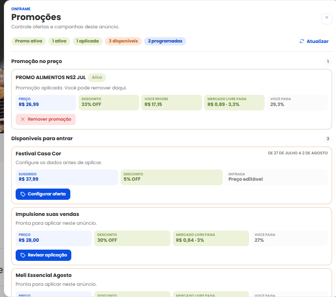
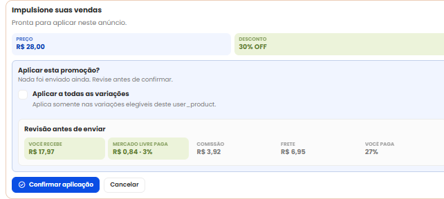
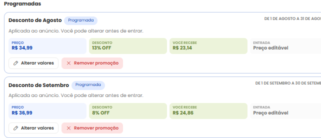

# Promocoes e acoes em massa

O onframe mostra promocoes, descontos, custos e oportunidades direto na pagina
do anuncio. A ideia e facilitar a revisao antes de aplicar, alterar ou remover
uma promocao.

## O que voce consegue fazer

Quando o Mercado Livre disponibiliza a acao para o anuncio, o onframe permite:

- aplicar uma promocao;
- configurar preco promocional;
- alterar valores antes da promocao entrar;
- remover uma promocao;
- revisar quanto voce recebe;
- revisar descontos, tarifa de venda, frete e beneficios do Mercado Livre;
- aplicar a mesma acao em outros anuncios elegiveis da familia.

## Entendendo os blocos de informacao

Os cards mostram apenas as informacoes mais importantes para decidir com
seguranca.

Voce pode encontrar:

- `Preco`: valor atual ou valor final da promocao.
- `Desconto`: percentual aplicado.
- `Voce recebe`: estimativa do valor que fica para o vendedor.
- `Com reducao de tarifas`: participacao promocional do Mercado Livre. No
  calculo financeiro, essa reducao ja aparece descontada da tarifa de venda.
- `Desconto do vendedor`: parcela do desconto comercial assumida pelo vendedor.
- `Bonus do Mercado Livre`: beneficio adicional de boost que reduz as tarifas
  por venda e ja aparece aplicado a tarifa liquida.
- `Tarifa de venda`: custo da venda depois das reducoes promocionais aplicaveis.
- `Frete`: custo relacionado ao envio.

O `Bonus do Mercado Livre` so aparece quando a API informa `boosted_offer`.
Cupons e descontos por pagamento continuam condicionais ao comprador ou a forma
de pagamento e nao entram na estimativa principal.

O valor `Voce recebe` e calculado como `preco promocional - tarifa de venda -
frete do vendedor`. Quando houver reducao, o onframe mostra o valor reduzido na
propria tarifa e informa quanto ja foi abatido, sem apresentar o aporte como uma
segunda receita.

Nem toda promocao tem todos os campos. Quando uma informacao nao existe para
aquele caso, o onframe evita preencher a tela com blocos vazios. A classificacao
de **Ativa**, **Programada** e **Disponivel** segue as
[regras de produto](../product/promocoes.md).

## Aplicar promocao

1. Abra o popover ou modal de promocoes e escolha uma oferta disponivel.
2. Use `Aplicar` para aceitar as condicoes ja apresentadas. Se a oferta exigir
   estoque reservado, informe apenas essa quantidade antes de confirmar.
3. Use `Configurar` quando quiser definir o preco promocional, ou quando a
   campanha nao apresentar um preco pronto para aceitar. Revise o calculo e
   confirme a aplicacao.

`Editar` aparece somente para participacoes ja aplicadas cujo tipo permite
alterar a oferta. `Ver detalhes` e a simulacao de custos nao modificam a oferta.

Enquanto o envio esta em andamento, o onframe mostra estado de carregamento para
evitar duvida sobre o que esta acontecendo.

## Alterar ou remover promocao

Promocoes ja aplicadas podem mostrar acoes como `Alterar valores` ou `Remover
promocao`, dependendo do tipo de campanha e das regras do Mercado Livre.

Antes de confirmar, leia a revisao exibida pelo onframe. Ela mostra o efeito da
acao no anuncio.

## Aplicar em outros anuncios da familia

No modelo User Product, uma familia pode reunir diferentes variantes fisicas,
e cada variante pode ter mais de uma condicao de venda (anuncio). A acao em
massa alcanca os anuncios ativos e pausados dessa familia, nao apenas uma
publicacao por variante.

Ao editar uma oferta que nao e cupom nem exige estoque reservado, marque
`Aplicar a outros anuncios da familia`. O primeiro clique no botao de
confirmacao verifica os anuncios da
familia e apresenta os elegiveis e os bloqueados, com o motivo. O segundo
clique envia a acao apenas aos elegiveis. Ofertas com estoque reservado devem
ser aplicadas anuncio por anuncio.

O envio pode ter resultados diferentes para cada anuncio. O modal separa os
aplicados, os que aguardam confirmacao do Mercado Livre e os nao aplicados,
com o motivo de cada falha. A mesma configuracao de preco e enviada aos
elegiveis; confira a previa porque cada anuncio pode ter limites diferentes.

## Boas praticas

Antes de confirmar uma promocao, confira:

- se o preco final esta correto;
- se o desconto faz sentido para a margem;
- se o valor `Voce recebe` esta dentro do esperado;
- se todos os anuncios desejados foram incluidos;
- se algum anuncio ficou de fora por regra do Mercado Livre.
